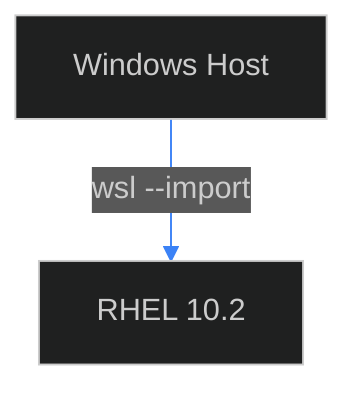

# Ficha de Design Visual — Lab RHEL + WSL2

**Versão:** 1.0  
**Data:** 08/Nov/2026  
**Autor:** Alex Luiz Rabelo — Cloud, DevOps & SRE  
**Repositório:** `AlexRabelo/lab-redhat-wsl2`

---

## 1. Paleta de cores

| Função | Cor | Uso |
|--------|-----|-----|
| Fundo escuro | `#08090c` | Fundo de imagens, painéis, seções |
| Acento ciano | `#22d3ee` | Destaques, links, elementos de foco |
| Azul secundário | `#3b82f6` | Elementos secundários, bordas de destaque |
| Borda | `#1e293b` | Bordas de imagens, cards, containers |
| Texto principal | `#f8fafc` | Títulos, texto principal |
| Texto secundário | `#94a3b8` | Legendas, descrições, notas |
| Sombra suave | `rgba(0, 0, 0, 0.45)` | Sombra de imagens e cards |

---

## 2. Tipografia

| Elemento | Fonte | Uso |
|----------|-------|-----|
| Títulos | Outfit | Cabeçalhos de seção, títulos de imagem |
| Corpo | Source Sans 3 | Texto descritivo, legendas, anotações |

---

## 3. Bordas e sombras

- **Raio de borda:** 8px
- **Espessura da borda:** 1px na cor `#1e293b`
- **Sombra:** `0 8px 24px -4px rgba(0, 0, 0, 0.45)` para imagens e cards

---

## 4. Dimensões alvo

- **Proporção:** 16:9
- **Dimensão recomendada:** 1200×675 px (ou múltiplos que mantenham 16:9)
- **Tamanho máximo por imagem:** abaixo de 500 KB quando possível (otimizar PNG)

---

## 5. Regras de borrado de PII (obrigatório)

Antes de publicar qualquer imagem, borrar ou remover:

- [ ] Nome de usuário real do Windows (substituir por `demo` ou borrar)
- [ ] E-mail da conta Red Hat Developer
- [ ] Senha ou Activation Key
- [ ] Endereços IP internos ou nomes de máquina reais
- [ ] Chaves de assinatura ou números de entitlement
- [ ] Qualquer informação identificável pessoal (PII)

Método: retângulo opaco sobre a área sensível, antes de salvar a imagem final.

---

## 6. Nomeação de arquivos

- Nomes em minúsculo, sem espaços
- Separador: hífen (`-`)
- Sufixo descritivo do conteúdo (ex: `wsl-import-command.png`, `dnf-repolist.png`)
- Caminho de destino: `assets/imgs/lab-rhel-wsl2/`

---

## 7. Diagrama Mermaid

- Tema: `dark` (`%%{init: {'theme': 'dark', ...}%%}`)
- Cores consistentes com a paleta acima
- Bordas e sombras coerentes com as regras de seção 3

---

## 8. Como capturar novas imagens

1. Capturar a tela (Print Screen, Snipping Tool, ou similar)
2. Abrir em GIMP ou editor equivalente
3. Redimensionar para 16:9 (ex: 1200×675) quando possível
4. Adicionar borda raio 8px, 1px `#1e293b`, sombra suave
5. Borrar qualquer dado pessoal conforme a seção 5
6. Salvar como PNG otimizado em `assets/imgs/lab-rhel-wsl2/` com nome em minúsculo e descritivo
7. Referenciar no tutorial com caminho relativo ``

---

## 9. Exemplos de inserção no Markdown

```markdown

```



---

*Última atualização: 08/Nov/2026*  
*Autor: Alex Luiz Rabelo — Cloud, DevOps & SRE*  
*Transparência de IA: Este arquivo foi compilado com auxílio de ferramentas de IA e revisado/testado manualmente pelo autor.*
