# Lab RHEL 10.2 no WSL2 — Guia Completo de Instalação e Registro

Portfólio de Alex Rabelo — Cloud, DevOps & SRE  
Laboratório de administração Linux com Red Hat Enterprise Linux no Windows Subsystem for Linux 2 (WSL2)

---

## Índice

1. [Visão Geral](#visão-geral)
2. [Pré-requisitos](#pré-requisitos)
3. [Passo 1 — Instalar o WSL2 no Windows](#passo-1-instalar-o-wsl2-no-windows)
4. [Passo 2 — Criar conta desenvolvedor na Red Hat](#passo-2-criar-conta-desenvolvedor-na-red-hat)
5. [Passo 3 — Baixar a imagem RHEL 10.2 para WSL2](#passo-3-baixar-a-imagem-rhel-102-para-wsl2)
6. [Passo 4 — Importar a imagem para o WSL2](#passo-4-importar-a-imagem-para-o-wsl2)
7. [Passo 5 — Registrar o sistema na Red Hat Subscription Manager](#passo-5-registrar-o-sistema-na-red-hat-subscription-manager)
8. [Passo 6 — Ver repositórios e atualizar com dnf](#passo-6-ver-repositórios-e-atualizar-com-dnf)
9. [Passo 7 — Configurar usuário padrão no WSL](#passo-7-configurar-usuário-padrão-no-wsl)
10. [Método alternativo — Image Builder (imagem customizada)](#método-alternativo-image-builder-imagem-customizada)
11. [Análise Crítica da Solução](#análise-crítica-da-solução)
12. [Análise Crítica do Projeto (Lab Red Hat + WSL2)](#análise-crítica-do-projeto-lab-red-hat--wsl2)
13. [Referências e Fontes Oficiais](#referências-e-fontes-oficiais)

---

## Visão Geral

Este laboratório documenta a instalação do **Red Hat Enterprise Linux (RHEL) 10.2** rodando nativamente no **Windows Subsystem for Linux 2 (WSL2)**, utilizando a **assinatura gratuita para desenvolvedores individuais da Red Hat**. O objetivo é ter um ambiente Linux corporativo real, com acesso aos repositórios oficiais via `dnf`, para estudos de administração Linux, automação de infraestrutura e preparação para certificações (ex: RHCSA).

Este é o **Lab 1 (base)** do portfólio de Alex Rabelo.

### Arquitetura da solução

%%{init: {'theme': 'dark', 'themeVariables': { 'primaryColor': '#08090c', 'primaryTextColor': '#f8fafc', 'primaryBorderColor': '#22d3ee', 'lineColor': '#3b82f6', 'secondaryColor': '#1e293b', 'tertiaryColor': '#fff' }}}%%
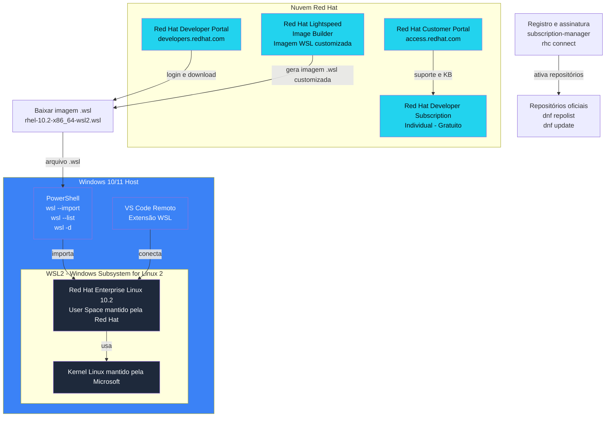

> **Nota:** O diagrama acima ilustra a separação de responsabilidades: a Microsoft mantém o kernel Linux do WSL2, enquanto a Red Hat mantém o user space do RHEL. A assinatura do desenvolvedor é o elo que conecta o ambiente local aos repositórios oficiais.


---

## Pré-requisitos

| Item | Detalhe |
|------|---------|
| Sistema operacional | Windows 10 (versão 2004+) ou Windows 11 |
| Virtualização | Habilitada na BIOS/UEFI (Intel VT-x ou AMD-V) |
| WSL | Habilitado no Windows (funcionalidade "Subsistema do Windows para Linux") |
| Conta Red Hat | Cadastro gratuito no [Red Hat Developer Program](https://developers.redhat.com/register) |
| Espaço em disco | Aprox. 200 MB para a imagem WSL + espaço para pacotes instalados |
| Memória | Recomendado: 4 GB ou mais livres para o WSL |

---

## Passo 1 — Instalar o WSL2 no Windows

O WSL2 é a camada de virtualização leve da Microsoft que roda um kernel Linux real dentro do Windows, sem necessidade de VMs pesadas (VMware/VirtualBox).

### No PowerShell (como Administrador):

```powershell
# Habilitar o WSL e a Plataforma de Máquina Virtual
dism.exe /online /enable-feature /featurename:Microsoft-Windows-Subsystem-Linux /all /norestart
dism.exe /online /enable-feature /featurename:VirtualMachinePlatform /all /norestart
```

Reinicie o Windows após a habilitação.

Defina o WSL2 como versão padrão:

```powershell
wsl --set-default-version 2
```

Verifique se o WSL está instalado:

```powershell
wsl --list --verbose
```

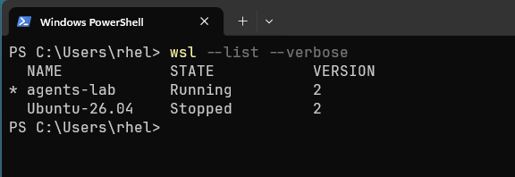

> **Fonte:** [Microsoft — How to install Linux on Windows with WSL](https://learn.microsoft.com/en-us/windows/wsl/install)

---

## Passo 2 — Criar conta desenvolvedor na Red Hat

A Red Hat oferece o **Red Hat Developer Subscription for Individuals**, uma assinatura **sem custo** que inclui:

- RHEL Server (binários idênticos aos de produção)
- Acesso a atualizações e errata de segurança
- Até **16 sistemas físicos ou virtuais** por conta
- Acesso ao Red Hat Customer Portal (base de conhecimento, fóruns)
- Suporte da comunidade (sem SLA de suporte empresarial)

### Como criar:

1. Acesse [developers.redhat.com/register](https://developers.redhat.com/register)
2. Preencha o formulário de cadastro (nome, e-mail, senha)
3. Confirme o e-mail de ativação
4. Acesse [developers.redhat.com/products/rhel/download](https://developers.redhat.com/products/rhel/download)
5. Faça login com sua conta Red Hat

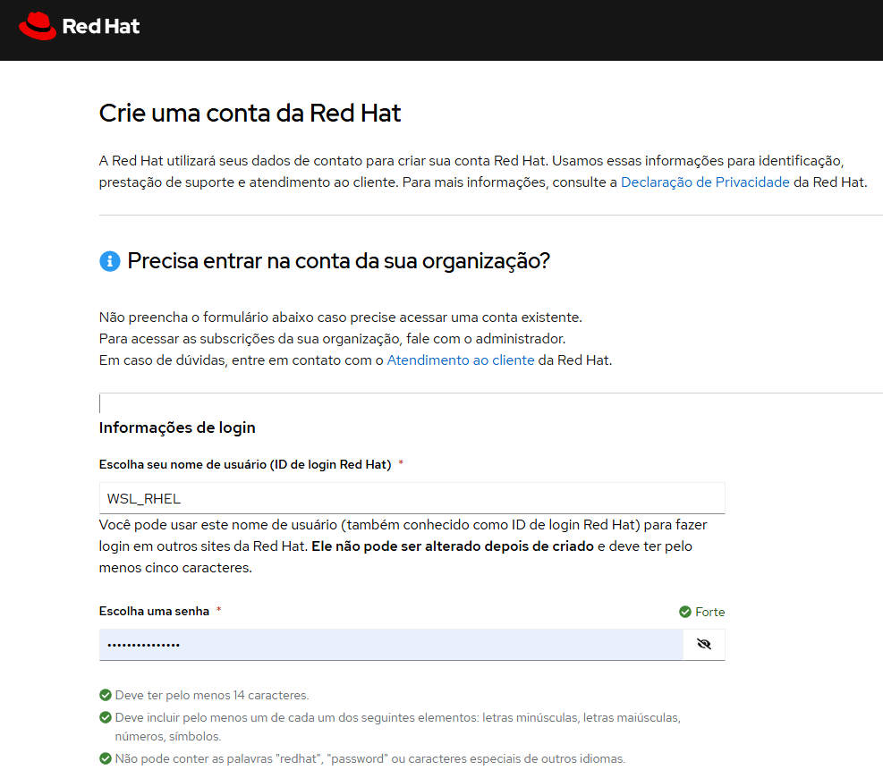

> **Fonte:** [Red Hat — No-cost Red Hat Enterprise Linux Individual Developer Subscription: FAQs](https://developers.redhat.com/articles/faqs-no-cost-red-hat-enterprise-linux)

---

## Passo 3 — Baixar a imagem RHEL 10.2 para WSL2

Na página de downloads da Red Hat, após fazer login, você encontrará a opção **WSL2 image** para a versão desejada.

### RHEL 10.2 — WSL2 image:
- **Arquivo:** `rhel-10.2-x86_64-wsl2.wsl`
- **Tamanho:** ~108,58 MB
- **SHA-256:** `4401fdfd04f4c200f30e351674e68e2e6c2d8ef1bd8cae9f03102da1225e8917`
- **Data de lançamento:** 12 de maio de 2026

### RHEL 9.8 — WSL2 image (alternativa mais estável):
- **Arquivo:** `rhel-9.8-x86_64-wsl2.wsl`
- **Tamanho:** ~131,58 MB
- **SHA-256:** `f42848107762a84d121ed1981230625439de7e97580b9b4ea8e8381e6da8f0eb`

> **Nota:** O arquivo `.wsl` já é um tar compactado pronto para importação direta com `wsl --import`. Não é necessário extrair manualmente.

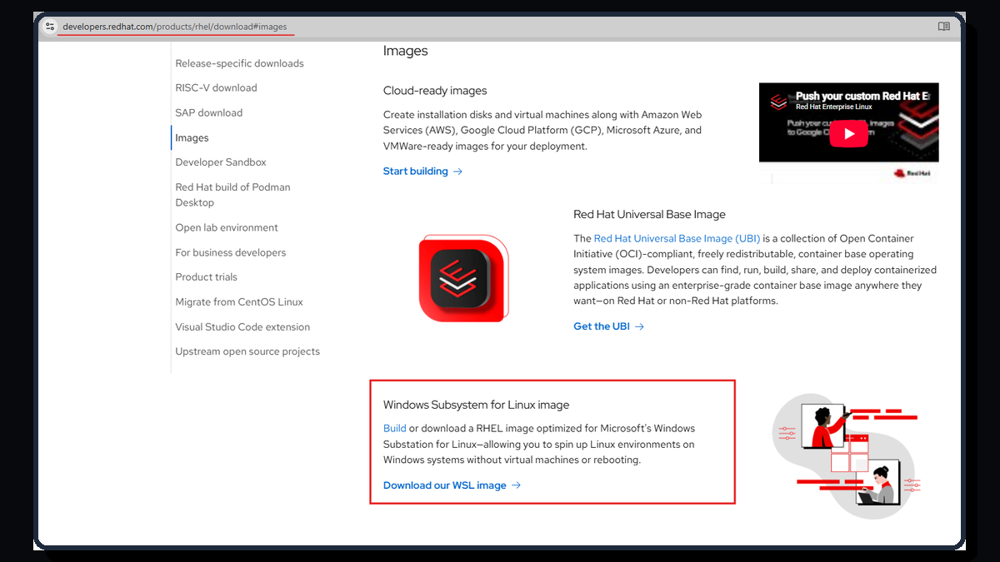

> **Fonte:** [Red Hat — Download Red Hat Enterprise Linux (RHEL)](https://developers.redhat.com/products/rhel/download)

---

## Passo 4 — Importar a imagem para o WSL2

No PowerShell (como Administrador):

```powershell
# Criar pasta para armazenar as distribuições WSL
mkdir $HOME\WSL

# Importar a imagem RHEL 10.2
wsl --import RHEL-10.2 $HOME\WSL\RHEL10.2 $HOME\Downloads\rhel-10.2-x86_64-wsl2.wsl
```

> **Nota sobre a extensão do arquivo:** O arquivo baixado do portal da Red Hat tem extensão **`.wsl`** (ex: `rhel-10.2-x86_64-wsl2.wsl`). Ele já é um tar compactado pronto para importação direta com `wsl --import` — não é necessário extrair manualmente nem renomear para `.tar.gz`. Se a sua captura de tela mostrar um nome terminado em `.tar.gz`, trata-se do mesmo arquivo compactado; o comando `wsl --import` aceita qualquer arquivo tar válido.

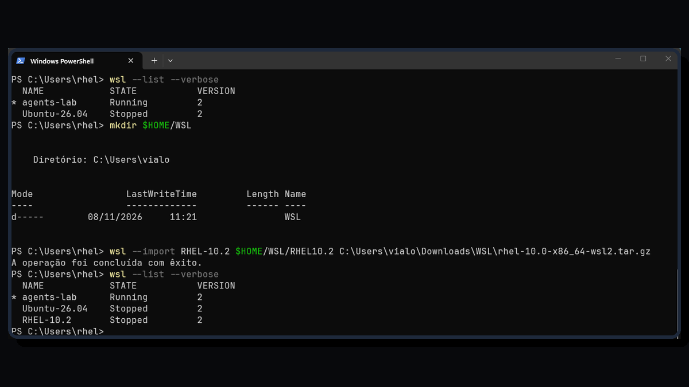

Parâmetros do `wsl --import`:
- `RHEL-10.2` — nome da distribuição como aparecerá no WSL
- `$HOME\WSL\RHEL10.2` — local onde a distro será instalada no disco do Windows
- `$HOME\Downloads\rhel-10.2-x86_64-wsl2.wsl` — caminho do arquivo `.wsl` baixado

### Definir como distribuição padrão (opcional):

```powershell
wsl -s RHEL-10.2
```

### Listar distribuições instaladas:

```powershell
wsl --list --verbose
```

Saída esperada:

```output
NAME          STATE           VERSION
* RHEL-10.2   Stopped         2
Ubuntu        Stopped         2
```

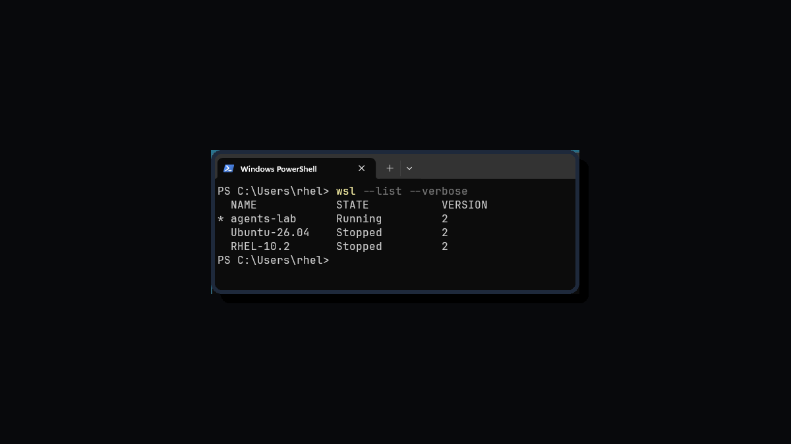

### Iniciar a distribuição:

```powershell
wsl -d RHEL-10.2
```

Ou, se definida como padrão:

```powershell
wsl
```

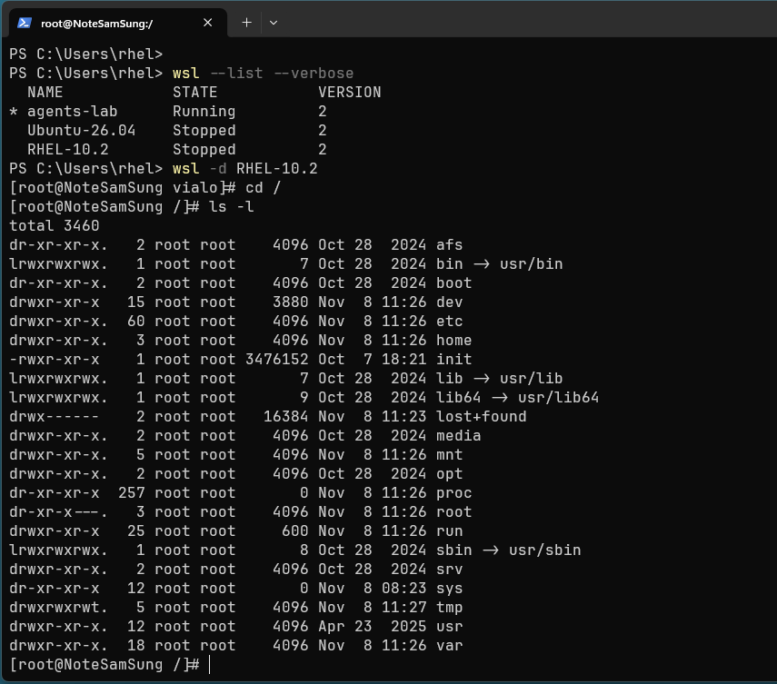

### Verificar a versão:

Dentro do terminal RHEL:

```bash
cat /etc/redhat-release
```

Saída esperada:

```output
Red Hat Enterprise Linux release 10.2
```

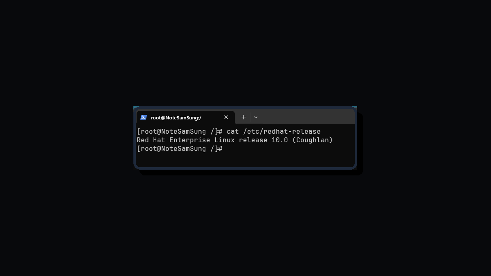

> **Fonte:** [Red Hat — Getting started with RHEL on WSL (maio 2025)](https://developers.redhat.com/articles/2025/05/20/getting-started-rhel-windows-subsystem-linux)  
> **Fonte:** [Microsoft — Import any Linux distribution to use with WSL](https://learn.microsoft.com/en-us/windows/wsl/use-custom-distro)

---

## Passo 5 — Registrar o sistema na Red Hat Subscription Manager

Sem registro, o sistema não consegue baixar pacotes ou atualizações dos repositórios oficiais da Red Hat.

### Opção A — Registrar com usuário e senha da Red Hat:

Dentro do WSL (como root):

```bash
subscription-manager register
```

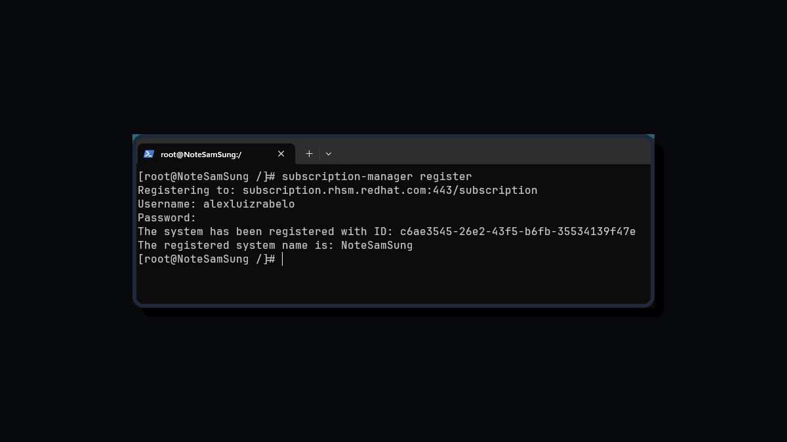

Digite o e-mail e senha da sua conta Red Hat Developer.

### Opção B — Registrar com chave de ativação (recomendado para automação):

Se você gerou uma activation key no [Hybrid Cloud Console](https://console.redhat.com/insights/image-builder):

```bash
subscription-manager register --org ORG_ID --activationkey KEY
```

Ou usando a nova ferramenta `rhc`:

```bash
rhc connect --organization ORG_ID --activation-key KEY
```

### Verificar o registro:

```bash
subscription-manager status
```

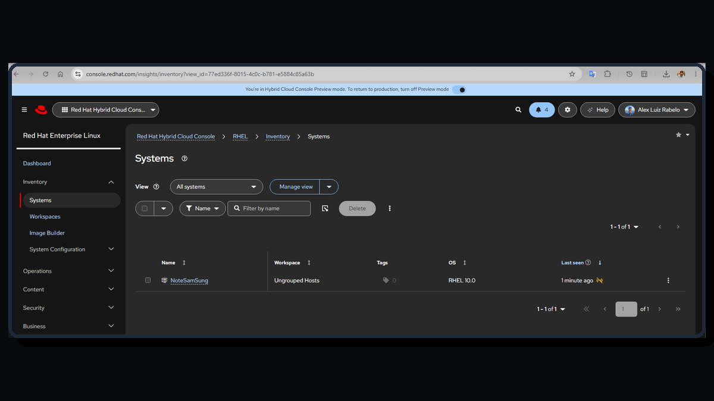

Saída esperada:

```output
+-------------------------------------------+
   System Status Details
+-------------------------------------------+
Overall Status: Registered
```

Ou com `rhc`:

```bash
rhc status
```

Saída esperada:

```output
Connection status for <hostname>:
✓ Connected to Red Hat Subscription Management
✓ Connected to Red Hat Insights
```

> **Fonte:** [Red Hat — How to register and subscribe a RHEL system](https://access.redhat.com/solutions/253273)  
> **Fonte:** [Red Hat — No-cost RHEL Developer Subscription FAQs](https://developers.redhat.com/articles/faqs-no-cost-red-hat-enterprise-linux)

---

## Passo 6 — Ver repositórios e atualizar com dnf

Após o registro, os repositórios oficiais da Red Hat ficam disponíveis.

### Listar repositórios habilitados:

```bash
dnf repolist
```

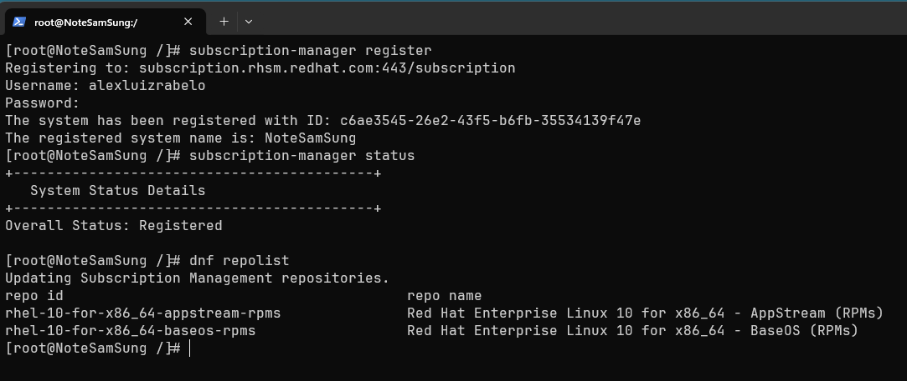

Saída esperada para RHEL 10.2:

```output
repo id                                                      repo name
rhel-10-for-x86_64-appstream-rpms    Red Hat Enterprise Linux 10 for x86_64 - AppStream (RPMs)
rhel-10-for-x86_64-baseos-rpms       Red Hat Enterprise Linux 10 for x86_64 - BaseOS (RPMs)
```

### Atualizar o sistema:

```bash
dnf update -y
```

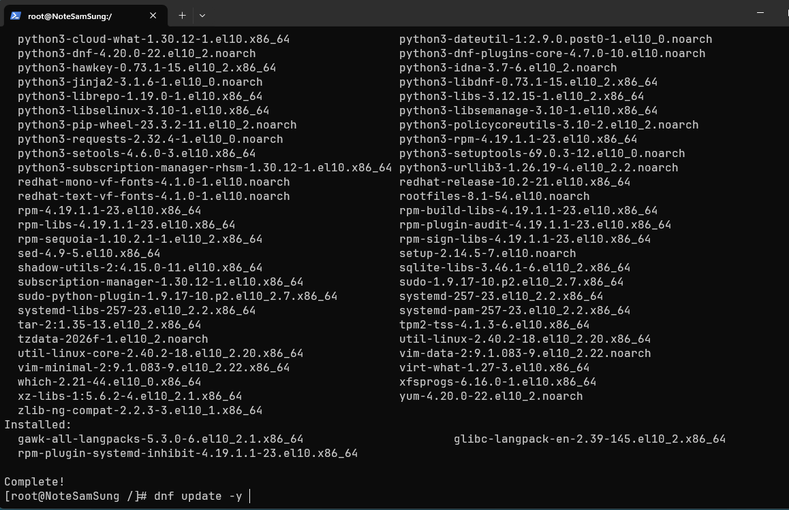

### Instalar pacotes úteis para estudo:

```bash
dnf install -y vim git wget curl tree htop tmux sudo
```

> **Nota:** O `dnf` é o gerenciador de pacotes do RHEL (sucessor do `yum`). Ele gerencia dependências automaticamente e trabalha com os módulos do AppStream e BaseOS.

> **Fonte:** [Red Hat — Getting started with RHEL on WSL](https://developers.redhat.com/articles/2025/05/20/getting-started-rhel-windows-subsystem-linux)

---

## Passo 7 — Configurar usuário padrão no WSL

Por padrão, o WSL inicia como o usuário `root`. É recomendado criar um usuário comum com privilégios `sudo` e defini-lo como padrão.

Dentro do WSL (como root):

```bash
useradd -m -G wheel demo
passwd demo
```

Adicionar ao `/etc/wsl.conf` para definir o usuário padrão automaticamente:

```bash
echo -e "[user]\ndefault=demo" >> /etc/wsl.conf
```

Saia do WSL e, no PowerShell, reinicie a distribuição:

```powershell
wsl --terminate RHEL-10.2
wsl -d RHEL-10.2
```

Agora você entrará automaticamente como o usuário `demo`. Para usar o `sudo`, adicione o usuário ao grupo `wheel` (já feito acima) e instale o `sudo` se necessário:

```bash
dnf install -y sudo
```

> **Fonte:** [Microsoft — Import any Linux distribution to use with WSL](https://learn.microsoft.com/en-us/windows/wsl/use-custom-distro)

---

## Método alternativo — Image Builder (imagem customizada)

A Red Hat oferece o **Red Hat Lightspeed Image Builder** (acessível via [console.redhat.com/insights/image-builder](https://console.redhat.com/insights/image-builder)) para criar imagens RHEL personalizadas com:

- Pacotes pré-selecionados
- Repositórios customizados
- Método de registro pré-configurado (activation key)
- Usuários e senhas definidos
- Idioma e teclado personalizados

O processo:

1. Acesse o Image Builder no Hybrid Cloud Console
2. Selecione **WSL** como tipo de saída (Image output)
3. Configure os pacotes e opções desejadas
4. Construa a imagem (leva poucos minutos)
5. Baixe o arquivo `.wsl` gerado
6. Importe com `wsl --import` como descrito no Passo 4

> **Vantagem:** Ideal para times que precisam de ambientes padronizados e reproduzíveis.  
> **Desvantagem:** Requer acesso ao Hybrid Cloud Console e conhecimento prévio do serviço.

> **Fonte:** [Red Hat — Getting started with RHEL on WSL (Opção 1)](https://developers.redhat.com/articles/2025/05/20/getting-started-rhel-windows-subsystem-linux)

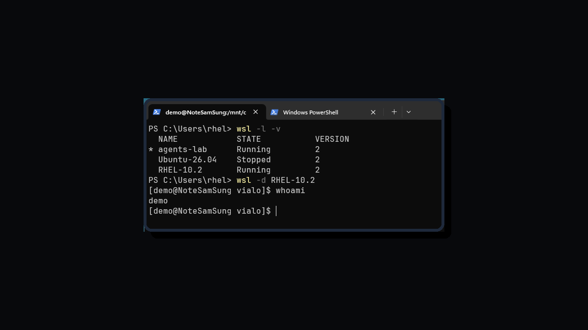

---

## Referências e Fontes Oficiais

| # | Fonte | Tipo | URL |
|---|-------|------|-----|
| 1 | Red Hat — Getting started with RHEL on WSL (maio/2025) | Documentação oficial Red Hat | https://developers.redhat.com/articles/2025/05/20/getting-started-rhel-windows-subsystem-linux |
| 2 | Red Hat — Download RHEL | Página de downloads oficiais | https://developers.redhat.com/products/rhel/download |
| 3 | Red Hat — No-cost RHEL Developer Subscription FAQs | FAQ oficial sobre assinatura gratuita | https://developers.redhat.com/articles/faqs-no-cost-red-hat-enterprise-linux |
| 4 | Red Hat — How to register and subscribe a RHEL system | KB oficial de registro | https://access.redhat.com/solutions/253273 |
| 5 | Microsoft — Import any Linux distribution to use with WSL | Documentação oficial da Microsoft | https://learn.microsoft.com/en-us/windows/wsl/use-custom-distro |
| 6 | Microsoft — How to install Linux on Windows with WSL | Documentação oficial de instalação WSL | https://learn.microsoft.com/en-us/windows/wsl/install |
| 7 | Red Hat — RHEL supported on WSL | Artículo de suporte | https://access.redhat.com/articles/7115538 |
| 8 | Red Hat — RHEL 10 on WSL as Podman machine | Artigo complementar | https://developers.redhat.com/articles/2025/05/21/how-use-rhel-10-wsl-podman-machine |


---

## Padrão visual das imagens

Todas as capturas de tela e o diagrama Mermaid deste lab seguem o
**[padrão de design visual](./docs/design-padrao-visual.md)**: paleta
dark tecnológica (`#08090c`, `#22d3ee`, `#3b82f6`), borda raio 16px em
`#1e293b`, sombra suave, dimensões 1200×675 (16:9) e borrado obrigatório
de dados pessoais (PII) antes de publicar.

---

*Última atualização: 08/Nov/2026*  
*Autor: Alex Luiz Rabelo — Cloud, DevOps & SRE*  
*Transparência de IA: Este tutorial foi compilado com auxílio de ferramentas de IA com base em fontes oficiais da Red Hat e Microsoft, e revisado/testado manualmente pelo autor.*